# 📘 Guide Complet & Officiel — Plateforme VR Creation Company

> **Site Officiel en Production :** [https://vrcreationcompany.com](https://vrcreationcompany.com)  
> 🔐 **Panneau d'administration sécurisé :** `https://vrcreationcompany.com/vrcreation_dashboard/`  
> 📍 **Siège & Coordonnées :** Ibn Batouta bureaux, Av. Youssef Ibn Tachfine, Tangier 90000, Maroc  
> 📞 **Téléphone / WhatsApp :** `+212 625 07 1498` | ✉️ **Email :** `contact@vrcreationcompany.com`  

---

## 🏗️ Architecture Globale du Projet

```mermaid
graph TB
    A["🌐 Plateforme VR Creation Company<br><b>https://vrcreationcompany.com</b>"] --> B["⚙️ Paramètres du Site & Branding"]
    A --> C["🎯 Services Métiers (8)"]
    A --> D["📁 Portfolio & Études de Cas"]
    A --> E["🎁 Packs & Offres Commerciales"]
    A --> F["✨ Blog & Rédacteur IA (Gemini 2.0)"]
    A --> G["📬 Messagerie & Notifications Anti-Spam"]
    A --> H["🔍 SEO Multilingue & Google Analytics"]
    
    B --> B1["Logo, Coordonnées NAP, Réseaux Sociaux"]
    B --> B2["Vidéo Hero 3D / Textes Accueil"]
    
    C --> C1["Modélisation 3D, Visites 360°, Photo, Branding"]
    C --> C2["Galeries photos HD par métier"]
    
    D --> D1["Projets réalisés & Visites virtuelles Iframe"]
    D --> D2["Études de cas orientées ROI commercial"]
    
    E --> E1["Offre Performance (Sur commission)"]
    E --> E2["Pack Débutants (Services personnalisables)"]
    
    F --> F1["Rédaction manuelle Markdown"]
    F --> F2["Génération automatisée IA Gemini Flash"]
    
    G --> G1["Notification Admin instantanée (Reply-To direct)"]
    G --> G2["Accusé de réception client (AR / FR / EN)"]
    
    H --> H1["Sitemap XML 78 URLs + Hreflang alternates"]
    H --> H2["GTM-5XMMF7G5 & Données structurées JSON-LD"]

    style A fill:#3d8eb9,color:#fff
    style E fill:#f59e0b,color:#fff
    style F fill:#8b5cf6,color:#fff
    style G fill:#10b981,color:#fff
```



---

## 1. 🔐 Administration du Site (`/vrcreation_dashboard/`)

Le panneau d'administration n'utilise pas l'URL standard `/admin/` pour des raisons de cybersécurité :
- **URL d'accès :** `https://vrcreationcompany.com/vrcreation_dashboard/`
- **Créer un nouvel administrateur (Superuser) :**
  ```bash
  source ~/virtualenv/vr_creation/3.12/bin/activate
  cd ~/vr_creation
  python manage.py createsuperuser --settings=config.settings.prod
  ```
  *(Ou directement via le shell Django) :*
  ```bash
  python manage.py shell --settings=config.settings.prod -c "from django.contrib.auth import get_user_model; User = get_user_model(); User.objects.create_superuser('admin_username', 'contact@vrcreationcompany.com', 'MotDePasseFort123!')"
  ```

---

## 2. ⚙️ Paramètres du Site (`Site Settings`)

> **Chemin Admin :** `Paramètres du site` → `Paramètres du site` (Entrée unique)

Permet de modifier l'intégralité des éléments de marque du site sans toucher au code :
- **Identité :** Nom du site (`VR Creation Company`), Slogan, Logo clair/sombre, Favicon (généré en multiples résolutions 32x32, 96x96, 180x180).
- **Coordonnées NAP (Name, Address, Phone) :** Adresse complète, téléphone officiel, numéro WhatsApp format international (`+212625071498`), email officiel.
- **Réseaux Sociaux :** Liens Facebook, Instagram, LinkedIn, TikTok, YouTube, et fiche Google Business Profile.
- **Vidéo / 3D Hero :** Fichier vidéo (MP4, WebM) ou 3D affiché en fond d'en-tête sur l'accueil et les pages intérieures.
- **Intégrations :** 
  - Code Google Search Console (`google_search_console_id`)
  - Google Analytics ID (`G-XXXXXXXXXX`)
  - URL Embed Google Maps (Iframe Ibn Batouta bureaux).

---

## 3. 🎯 Gestion des Services Métiers (8 Services)

> **Chemin Admin :** `Services` → `Services`

Chaque service dispose d'une page vitrine dédiée optimisée pour le référencement local à Tanger :
1. **Modélisation 3D** (`modelisation-3d`)
2. **Visites virtuelles 360°** (`visites-virtuelles`)
3. **Captures 360° & Drone** (`captures-360`)
4. **Photographie professionnelle** (`photographie`)
5. **Branding & Communication visuelle** (`branding-visuel`)
6. **Animation & Motion design** (`animation-motion-design`)
7. **Création de sites web** (`creation-sites-web`)
8. **Marketing digital & Lead generation** (`lead-generation`)

### Fonctionnalités disponibles par service :
- **Titres et descriptions multilingues** (Français, Anglais, Arabe).
- **Galerie d'images inline** : Permet d'attacher un nombre illimité de photos de réalisations avec ordre d'affichage personnalisable.
- **CTA WhatsApp direct** : Intègre un message pré-rempli ciblant le service sélectionné.

---

## 4. 📁 Portfolio, Réalisations & Études de Cas

> **Chemin Admin :** `Portfolio` → `Projets` & `Études de cas`

- **Projets (`/portfolio/`) :** Présentation détaillée de vos réalisations avec client, défi technique, solution apportée, galerie d'images et lecteur Iframe pour les visites virtuelles 360° immersives.
- **Études de cas (`/etudes-de-cas/`) :** Structure orientée business et retour sur investissement (Problématique → Importance du service → Résultat mesurable → Efficacité commerciale).

---

## 5. 🎁 Packs Commerciaux & Promotions

> **Chemin Admin :** `Promotions` → `Packs promotionnels`

Permet de structurer des offres à fort impact commercial :
- **Offre Performance (Sur commission) :** 
  - *Mise en avant = Oui* | *Personnalisable = Non*
  - VR Creation gère toute la chaîne de production visuelle et de commercialisation, rémunérée au succès (commission par vente).
- **Pack Débutants / Sur-mesure :**
  - *Mise en avant = Non* | *Personnalisable = Oui*
  - Le visiteur peut cocher et décocher les prestations directement sur la page web pour estimer son besoin.
- **Éléments modulables :** Frise chronologique d'accompagnement, tableau comparatif (« Sans VR Creation » vs « Avec VR Creation »), livrables et vidéo de présentation.

---

## 6. ✨ Blog & Rédacteur Intelligent IA (Google Gemini)

> **Chemin Admin :** `Blog` → `Articles` → Bouton **« ✨ Générer un article avec l'IA »**

La plateforme intègre nativement **Google Gemini 2.0 Flash** pour assister l'équipe dans la stratégie de contenu :
1. Renseignez un sujet ou des mots-clés cibles (ex: *« Pourquoi la visite virtuelle 360° accélère les ventes immobilières à Tanger »*).
2. Choisissez la **langue** (🇫🇷 FR, 🇬🇧 EN, 🇸🇦 AR), le **ton** (Expert, Dynamique, Pédagogique) et la **longueur**.
3. En 5 à 10 secondes, l'IA produit :
   - Titre optimisé SEO
   - Extrait percutant
   - Article complet structuré en Markdown (H2, H3, puces)
   - Données méta pour Google
4. L'article est enregistré en **Brouillon sécurisé** : vous le relisez, ajoutez une photo, et publiez à votre rythme.

---

## 7. 📬 Système de Messagerie & Emails Anti-Spam

> **Chemin Admin :** `Contact` → `Demandes de contact`

Toute soumission sur le formulaire de contact déclenche immédiatement **deux e-mails au format multipart (HTML moderne épuré + texte brut)** :
1. **Notification Administrateur** (`contact@vrcreationcompany.com`) :
   - Détails complets du prospect (Nom, email, téléphone, secteur d'activité, sujet, message).
   - En-tête `Reply-To` configuré sur l'adresse du client : il vous suffit de cliquer sur **« Répondre »** dans votre messagerie pour lui écrire directement.
2. **Accusé de réception client** :
   - Design élégant sans images externes (0 risque de passer en spam).
   - Récapitulatif de sa demande et promesse d'une réponse sous 24h ouvrées.
   - Traduit automatiquement selon la langue de soumission (**Français**, **Anglais** ou **Arabe avec mise en page RTL**).

### Commande de test SMTP instantané :
```bash
python manage.py test_email [email_optionnel] --settings=config.settings.prod
```

---

## 8. 🔍 Référencement Naturel (SEO), Google Search Console & Analytics

- **Sitemap XML Multilingue :** `https://vrcreationcompany.com/sitemap.xml`
  - Indexe automatiquement **78 URLs** réparties entre Français (`/fr/`), Anglais (`/en/`) et Arabe (`/ar/`).
  - Intègre **234 balises `<xhtml:link rel="alternate" hreflang="..."/>`** pour un classement optimal de chaque langue par Google.
- **Fichier Robots :** `https://vrcreationcompany.com/robots.txt` (autorise tous les moteurs, protège le tableau de bord).
- **Google Tag Manager / Analytics :** Conteneur `GTM-5XMMF7G5` pré-injecté dans le `<head>` de toutes les pages.
- **Données structurées Schema.org :** Balises `LocalBusiness` et `Organization` avec coordonnées NAP exactes de Tanger.

---

## 🖥️ Fiche Technique & Commandes de Déploiement

### Environnement Serveur (Namecheap Stellar Plus) :
- **Serveur :** `premium69.web-hosting.com` (cPanel user: `mediyezw`)
- **Version Python :** Python 3.12 (Virtualenv : `~/virtualenv/vr_creation/3.12/`)
- **Dossier de l'application :** `~/vr_creation/`
- **Serveur Web :** LiteSpeed / CloudLinux Passenger
- **Base de données :** SQLite (`~/vr_creation/data/db.sqlite3`)

### Fichier d'environnement (`~/vr_creation/.env`) :
```ini
DJANGO_SETTINGS_MODULE=config.settings.prod
DJANGO_SECRET_KEY=votre_cle_secrete_django
DJANGO_ALLOWED_HOSTS=vrcreationcompany.com,www.vrcreationcompany.com,localhost,127.0.0.1
CSRF_TRUSTED_ORIGINS=https://vrcreationcompany.com,https://www.vrcreationcompany.com
SITE_DOMAIN=vrcreationcompany.com
SITE_PROTOCOL=https

# Configuration Email SMTP Namecheap
EMAIL_BACKEND=django.core.mail.backends.smtp.EmailBackend
EMAIL_HOST=premium69.web-hosting.com
EMAIL_PORT=465
EMAIL_USE_SSL=True
EMAIL_USE_TLS=False
EMAIL_HOST_USER=contact@vrcreationcompany.com
EMAIL_HOST_PASSWORD="VotreMotDePasseBoiteMail"
DEFAULT_FROM_EMAIL=VR Creation <contact@vrcreationcompany.com>
CONTACT_EMAIL=contact@vrcreationcompany.com

# Clé IA Gemini (Pour le blog)
GEMINI_API_KEY=votre_cle_gemini_optionnelle
```

### Commandes usuelles sur le serveur :
```bash
# 1. Activer l'environnement virtuel
source ~/virtualenv/vr_creation/3.12/bin/activate && cd ~/vr_creation

# 2. Mettre à jour le code depuis GitHub
git pull origin main

# 3. Tester la configuration Email
python manage.py test_email --settings=config.settings.prod

# 4. Redémarrer le serveur après une modification
touch tmp/restart.txt
```

---
*Document certifié conforme à la version en production — VR Creation Company.*
